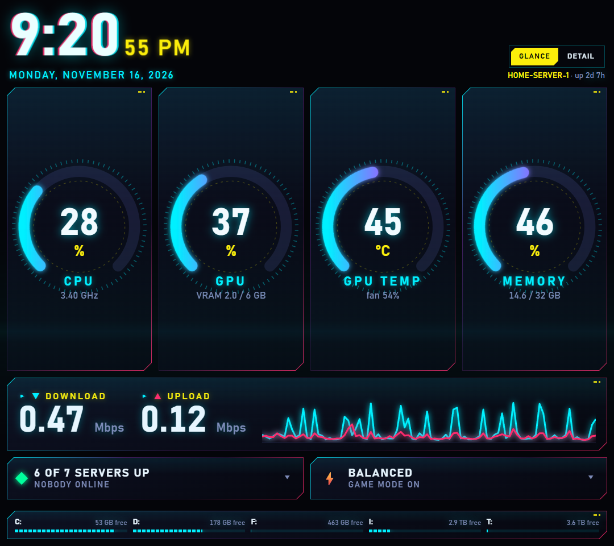
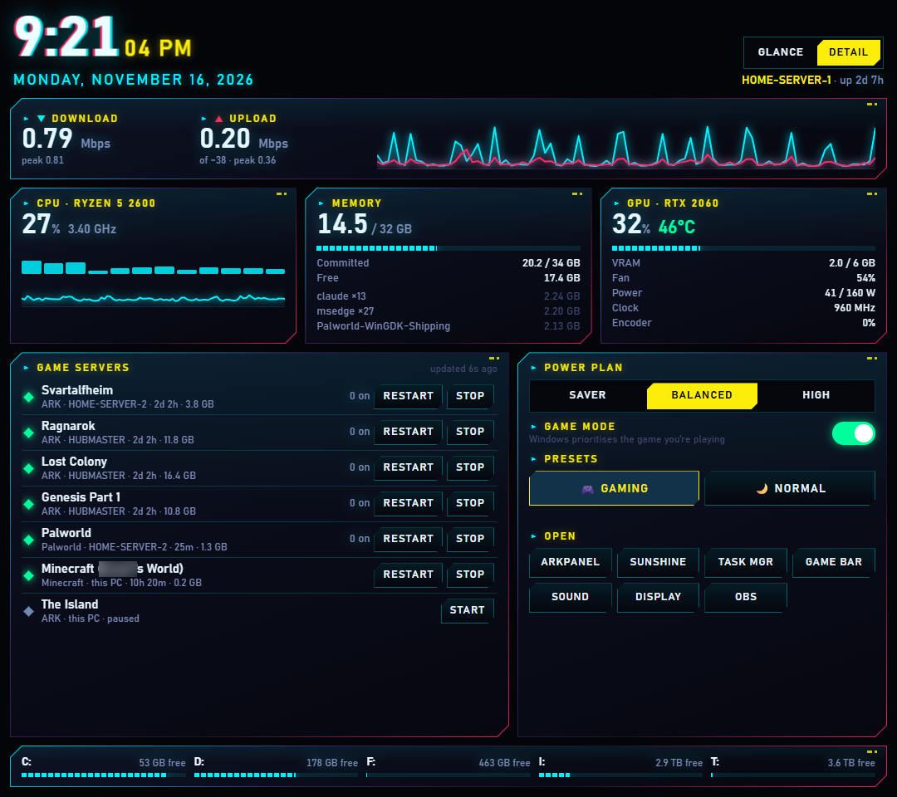
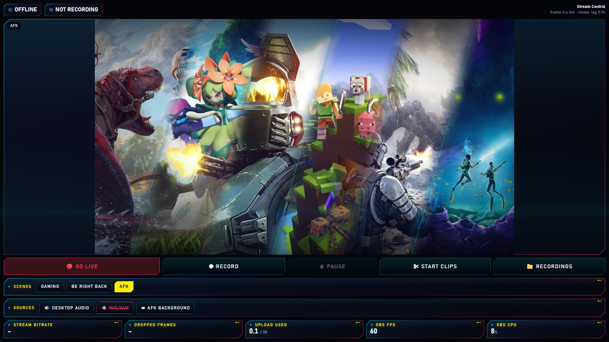
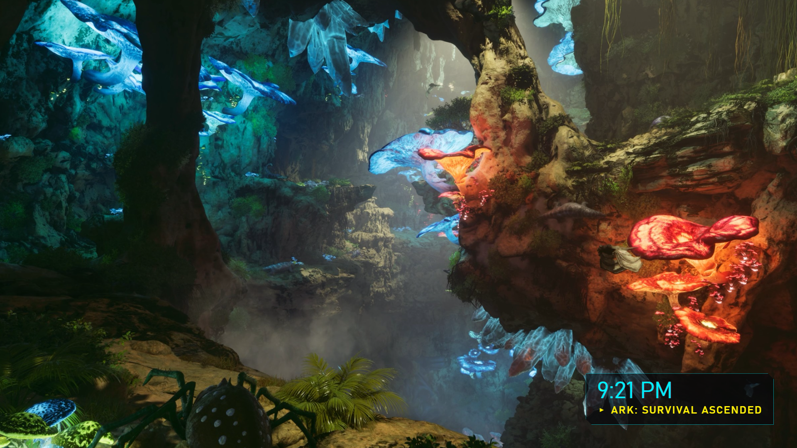
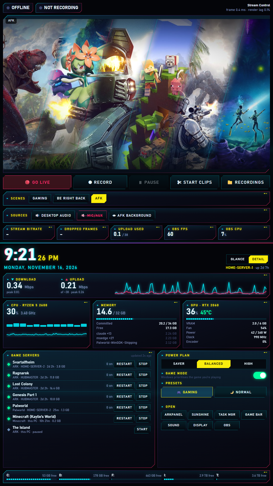

# PCDash

**A gaming-and-streaming command centre for one Windows PC.** It's a live stats dashboard for a spare portrait monitor, with:
- game-server buttons;
- OBS stream control;
- a webcam background that changes with the game;
- a game-art screensaver;
- the firmware and links for three small hardware controllers: a 5" WiFi touchscreen, a round stream screen and a USB key pad.

PCDash is the sister project of [ArkPanel](../ArkPanel). It runs on the same PC and reads game-server status through ArkPanel's API, but it's a separate app.



> The screenshots come from a live install. IP addresses, keys and world names are blurred.

---

## What it does

### The dashboard (`dash.py`, Flask on `127.0.0.1:8095`)

- **Glance view:** clock, large CPU, GPU, GPU temperature and memory gauges, network graph, game-server summary, power plan and drive space.
- **Detail view:** per-core CPU, committed and free memory, the processes using the most memory, GPU VRAM, fan, power, clock and encoder load, plus:
  - **Game servers:** every server with its host, uptime, memory and Restart, Stop and Start buttons (through ArkPanel);
  - **Power plan:** Saver, Balanced or High; Windows Game Mode; *Gaming* and *Normal* presets;
  - **Open:** one-tap launchers for ArkPanel, Sunshine, Task Manager, Game Bar, Sound, Display and OBS.
- It's laid out for **half of a 1080×1920 portrait monitor** (1080×960).

### The portrait screen (`/onn`, `onn_view.py`, `pcdash_tray.pyw`)

- One window fills the portrait monitor: **Stream Control on top, PC Dashboard below**. Swiping on the round stream screen switches views (split, dashboard only, stream only).
- It runs from the **system tray**, one program that also hosts the dashboard server.

### Stream control (`/stream`, `obs.py`)

- Go live, record, pause, start clips and switch scenes. It also shows bitrate, dropped frames, upload, FPS and OBS CPU.
- OBS WebSocket v5 is spoken directly with `wsproto`. **The OBS password is read at runtime from OBS's own settings**, so it's never copied anywhere.

### Webcam background (`cam_background.py`, `backgrounds.json`)

- The webcam uses NVIDIA Background Removal, and an image source sits behind it. PCDash swaps that image for **the game you're playing**, using your own picture or a softened copy of the game's art.

### Game-art screensaver (`/saver`, `saver.py`, `saver.json`)

- After a set idle time, it shows full-screen art of the game you're playing or last played. A portrait poster is used on the portrait screen.
- It **never** starts while a video or game keeps the screen awake, while a full-screen app is up or while the PC is locked. Any key, mouse or controller input ends it.
- It's a PCDash page rather than a `.scr` file, because Windows Smart App Control blocks unsigned, self-built `.scr` programs. The C# source of that `.scr` is still in `screensaver/`.

### Desktop helpers

| File | Job |
|---|---|
| `window_placer.py`, `screens.json` | Moves chosen programs, such as slicers, CAD and games, to the **main** screen when they open. The portrait screen is the Windows primary display, so everything else opens there. |
| `taskbar_hide.py` | Removes Discord's and ArkPanel's taskbar *buttons* using `ITaskbarList::DeleteTab`. It never hides or restyles the windows. |
| `audio_mixer.py`, `mixer.json` | Per-app volume and mute through Windows Core Audio called directly with `ctypes`, so pycaw isn't needed. Volumes are remembered per app. |
| `game_art.py`, `make_tile_art.py`, `games.json` | Tile art for every game and app. It uses your own picture, a file in `game-art/` or the game's own Store splash screen. |
| `remote.py` | **Web remote:** the touchscreen's interface on your phone, on port 8096, protected by a key. It works over WiFi or Tailscale. |

### Hardware controllers

| Device | Folder / link | What it does |
|---|---|---|
| **K-Touch**: 5" ESP32 WiFi touchscreen | `ktouch-fw/` (PlatformIO, LVGL), `ktouch_link.py` | Tabs for games, servers, stream and PC. PCDash sends it the whole state every second; taps come back as actions such as launching a game, sending it to a screen, restarting a server or changing a volume. |
| **KNOMI 2**: round stream screen | `knomi_link.py` (firmware is a patched build of BTT's KNOMI firmware, not included) | Shows stream status. Swipes switch the portrait screen's view and taps run OBS actions. |
| **HBB**: an RP2040 board reflashed as a key pad | `hbb/code.py`, `hbb/boot.py` (CircuitPython), `hbb_link.py` | 7 keys for OBS: scenes, mute, start and stop. The key lights follow the stream state over a second USB serial port. |
| **Keycaps** for the HBB | `hbb-keycaps/` | Python scripts that generate multi-colour 3D-printable keycaps as 3MF files. |

---

## Screens

| | |
|---|---|
| **Glance**<br> | **Detail**: servers, power plan and launchers<br> |
| **Stream overlay / control page**<br> | **Screensaver**<br> |
| **The portrait screen**: Stream Control on top, dashboard below<br> | |

---

## Install

Requirements: Windows 10 or 11 and Python 3.12. OBS 28 or newer with WebSocket enabled is optional. [ArkPanel](../ArkPanel) is optional too: it's needed for the server buttons.

```bash
pip install -r requirements.txt
pythonw pcdash_tray.pyw
```

- `launch.ps1` starts it the same way, and is suited to a logon scheduled task.
- The dashboard is at `http://127.0.0.1:8095`. It **only listens on this PC**. The phone remote is the separate, key-protected `remote.py`.
- To sign in to ArkPanel, PCDash reads ArkPanel's `secrets.json` from `..\ArkPanel\`, so keep the two projects side by side.

**K-Touch firmware:**
1. Copy `ktouch-fw/src/app/ktouch_token.example.h` to `ktouch_token.h` and set the token.
2. Build and flash with PlatformIO:
   ```bash
   pio run -e app -t upload
   ```

**HBB:** copy `hbb/code.py` and `hbb/boot.py` to the CircuitPython drive.

---

## Configuration files

| File | Holds |
|---|---|
| `games.json` | the games and apps on the touchscreen's Apps tab: Start-menu AppID, window match, tile art |
| `screens.json` | programs that open on the main screen |
| `backgrounds.json` | webcam background for each game |
| `saver.json` | screensaver idle times and rules |
| `mixer.json` | remembered per-app volumes |
| `hbb.json` | which OBS source and scenes the HBB keys control |
| `ktouch.json`, `knomi.json`, `remote.json` | device addresses and shared keys. **Git-ignored**, created on first run. |

Every JSON file has a `_comment` that explains its fields.

---

## Project layout

```
pcdash_tray.pyw     tray app: runs the server + the portrait window
dash.py             Flask dashboard + API (stats, servers, power, launchers)
onn_view.py         portrait-screen view switching
obs.py              OBS WebSocket v5 client
cam_background.py   per-game webcam background
saver.py            game-art screensaver
window_placer.py    send chosen programs to the main screen
taskbar_hide.py     hide taskbar buttons only
audio_mixer.py      per-app volume (Core Audio via ctypes)
game_art.py, make_tile_art.py   tile art
remote.py           phone web remote (:8096, key-protected)
ktouch_link.py, knomi_link.py, hbb_link.py   hardware links
static/             dashboard, portrait, stream, saver and remote pages
ktouch-fw/          ESP32 touchscreen firmware (PlatformIO + LVGL)
hbb/                RP2040 key pad (CircuitPython)
hbb-keycaps/        3D-printable keycap generator
screensaver/        the original .scr (C#), kept for reference
tools/              icon, channel-art and stream-screen generators
```

Game artwork (`game-art/`), stream graphics (`stream-screens/`), firmware dumps and device keys aren't included.
